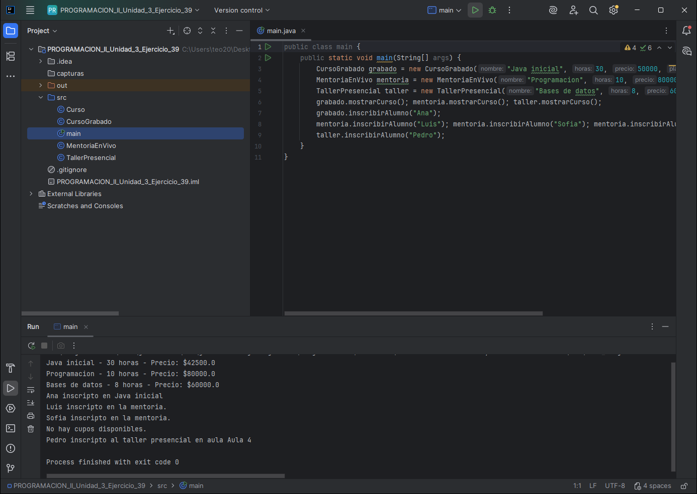

# PROGRAMACIÓN II — Unidad 3, Ejercicio 39: Jerarquía de Cursos y Capacitaciones Educativas

Trabajo práctico de Programación II. Este repositorio contiene la resolución en Java del ejercicio 39 de la Unidad 3.

## Consigna

#### Contexto

Una plataforma de educación online imparte programas de formación que comparten metadatos generales como el nombre del curso, la carga horaria total y el costo de inscripción. Sin embargo, los cursos grabados en video a su propio ritmo, las mentorías sincrónicas en vivo y los talleres presenciales intensivos requieren lógicas de seguimiento de alumnos y evaluación muy divergentes.

#### Consigna

Construir una solución orientada a objetos en Java que utilice herencia para modelar un curso educativo genérico y sus modalidades de cursada especializadas.

#### Desarrollo requerido

- Definir la clase base Curso comúnmente provista de atributos como nombreCurso, horasTotales y precioBase, junto a un método para calcular el costo final según descuentos aplicables.
- Desarrollar clases hijas como CursoGrabado (con plataforma de alojamiento y fecha límite de acceso), MentoríaEnVivo (con enlace de videollamada y cupo máximo de asistentes) y TallerPresencial (con número de aula y dirección física).
- Sobrescribir el método de inscripción de alumnos en las subclases para validar cupos disponibles o restricciones de conectividad.
- En el método main, instanciar cursos de diferentes modalidades, simular inscripciones de estudiantes y mostrar el estado de la oferta académica por consola.

## Estructura del repositorio

```
PROGRAMACION_II_Unidad_3_Ejercicio_39/
├── README.md
├── capturas/
│   └── consola.png
└── src/
    ├── Curso.java
    ├── CursoGrabado.java
    ├── main.java   # clase con el método main
    ├── MentoriaEnVivo.java
    └── TallerPresencial.java
```

## Funcionamiento y lógica

El ejercicio aplica **herencia y sobrescritura** en una plataforma de cursos con modalidades distintas.

### `Curso` (clase base)

Tiene `nombreCurso`, `horasTotales` y `precioBase` (`protected`).

- **`calcularCostoFinal()`:** devuelve el precio base.
- **`inscribirAlumno(String)`:** inscribe al alumno sin restricciones.
- **`mostrarCurso()`:** muestra nombre, horas y precio final.

### Subclases

- **`CursoGrabado`:** sobrescribe `calcularCostoFinal()` con un **15 % de descuento**.
- **`MentoriaEnVivo`:** tiene un cupo máximo. Su `inscribirAlumno()` lleva la cuenta de inscriptos y rechaza al alumno cuando no quedan cupos.
- **`TallerPresencial`:** su `inscribirAlumno()` informa en qué aula se cursa.

### `main`

Muestra los tres cursos:

- Java inicial (grabado) → $50000 con descuento = **$42500**.
- Programación (mentoría) → **$80000**.
- Bases de datos (taller) → **$60000**.

Después inscribe alumnos. En la mentoría, con cupo de 2, Luis y Sofía entran y Juan es rechazado por falta de cupo. Ana y Pedro se inscriben sin problemas en el curso grabado y en el taller.

## Ejecución

Captura de la consola de IntelliJ IDEA ejecutando el programa:



Salida obtenida:

```
Java inicial - 30 horas - Precio: $42500.0
Programacion - 10 horas - Precio: $80000.0
Bases de datos - 8 horas - Precio: $60000.0
Ana inscripto en Java inicial
Luis inscripto en la mentoria.
Sofia inscripto en la mentoria.
No hay cupos disponibles.
Pedro inscripto al taller presencial en aula Aula 4
```
